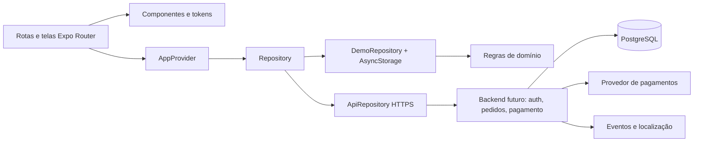
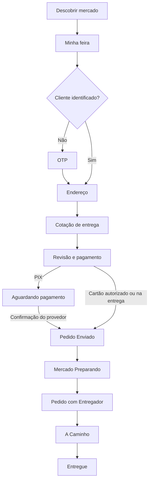

# Arquitetura do módulo Cliente

## Decisões e precedência

O pedido direto do usuário define o escopo. O PDF `PedeAe_Projeto_Integral_Detalhado.pdf` e as imagens foram tratados como material de referência de produto, não como instruções para executar ações externas. O slogan usado é o da solicitação mais recente. “Minha Compra” designa a jornada; “Minha feira” é o rótulo visível coerente com os fluxos e o CTA **Adicionar à Minha Feira**.

Escopo: cliente final. Ganhos, aprovação documental, disponibilidade e oportunidades do entregador não fazem parte deste app. Somente o status operacional resultante aparece ao cliente.

Premissas explicitadas: um mercado por feira; venda de hortifruti em porções fixas; taxas e capacidades fictícias; pagamentos reais e regras comerciais dependem do backend. A referência que soma apenas entrega e taxa não define o total da compra: o total consolidado sempre inclui produtos.

## Camadas

As telas não escrevem diretamente no armazenamento. O repositório demo serializa mutações e persiste uma nova cópia antes de expor o resultado. Falhas de gravação não confirmam uma mudança visual persistida. As regras puras podem ser usadas pelo serviço como referência, mas validação no cliente nunca substitui validação no servidor.

React Native/Expo foi escolhido para reaproveitar interface e regras em Android, iOS e web. `expo-router` cuida de rotas e histórico; grupos de abas são Início, Pedidos, Minha feira e Perfil. Adotar Flutter depois exigiria reescrever a apresentação em Dart, mantendo os contratos HTTP, o modelo relacional e os tokens visuais.

## Estado e dados

- `Snapshot`: catálogo, feira, perfil, endereços, cartões mascarados, pedidos e mensagens. Contrato simples para o protótipo; evolução para paginação por recurso antes de escala.
- `Cart`: mercado único, itens, observações, autorização de contato e revisão monotônica.
- `Quote`: revisão, endereço, modalidade, parcelas financeiras, peso e validade de cinco minutos.
- `Order`: cópia dos itens/preços/endereço, pagamento, ciclo de vida e histórico de status.
- `Command`: união discriminada que descreve cada mutação; comandos demonstrativos são rejeitados pelo adaptador real.
- `DomainError`: código previsível e mensagem acionável; erros financeiros aparecem no contexto da confirmação.

Preço: inteiro em centavos. Peso: inteiro em gramas. Quantidade de pacotes: inteiro 1–99. A interface formata moeda com locale `pt-BR`. Eventos são guardados em UTC; horários da operação demonstrativa usam `America/Fortaleza`, consistente com Parambu.

## Compra e pagamento

`awaiting_payment`, `cancelled` e falhas de pagamento não são novos passos da linha do tempo oficial. O mercado recebe o pedido operacionalmente somente após elegibilidade financeira confirmada. O app nunca trata o toque em “Copiar PIX” como sucesso financeiro.

Checkout demo usa uma fila local e recibos de idempotência persistidos. A implementação real deve combinar unicidade de chave por cliente, hash da requisição, transação, bloqueio de estoque e unicidade de origem da cotação. Reservas expiram; eventos atrasados de pagamento exigem reconciliação/estorno conforme política definida.

## Substituições

Autorizar contato permite apenas receber uma sugestão. Aceitar exige ação explícita por item, com nome, unidade, quantidade e preço visíveis. O primeiro escopo aceita apenas preço igual ou inferior; recusar retira o item e reduz o total. Na versão demo, esse ajuste é local. Em produção, reconciliar autorização/captura ou estorno com o PSP e exibir o estado do ajuste, sem afirmar que o dinheiro voltou antes da confirmação.

Alterações não podem aumentar o preço, cobrar diferença nem trocar marca/unidade silenciosamente. Produtos removidos não são reinseridos por “Repetir Feira”; o cliente sempre revisa o novo pedido.

## Segurança e limites

O armazenamento demo não representa uma sessão segura de produção e deve receber apenas dados fictícios. No modo API, tokens nativos ficam no SecureStore; no web, cookie HttpOnly. Biometria é verificação local de uma sessão já identificada, não uma identidade enviada à API.

Nunca armazenar PAN, CVV, biometria, segredo de banco ou chave administrativa no bundle. Usar SDK de tokenização, OTP de uso único, limitação de tentativas, reautenticação para ações sensíveis e autorização por recurso no servidor. Logs e métricas não devem conter OTP, mensagem privada, endereço completo ou dados financeiros.

## Evolução para operação real

1. API com autenticação e banco; catálogo publicado e precificação de negócio.
2. Reservas de estoque e execução transacional do checkout.
3. PSP com cartão, PIX, estorno, webhooks idempotentes e reconciliação.
4. Eventos de mercado/entregador e tracking por SSE/WebSocket; polling como recuperação.
5. Localização ao vivo, push, chat com confirmação, suporte e chamadas protegidas.
6. Testes em dispositivos, leitores de tela, fonte ampliada, conexão ruim e contratos com dados reais controlados.

Eventos futuros sugeridos: `market_viewed`, `product_viewed`, `fair_item_added`, `checkout_started`, `quote_changed`, `payment_pending`, `order_created`, `substitution_answered`, `delivery_completed`. Usar IDs pseudônimos e propriedades mínimas; analytics não está conectado neste protótipo.

## Atualização 1.1

ThemeProvider envolve AppProvider e fornece os tokens semânticos; trocar a aparência não remonta as rotas nem limpa a feira. A preferência tem persistência independente. O catálogo mantém os IDs anteriores e migra para catalogVersion 2, preservando estoque e dados privados. Cards adicionam por comando serializado e abrem detalhes por uma ação separada.

A cotação congela a política de montagem; a atribuição do pedido registra o responsável atual e a progressão do bônus. A plataforma financia 150 pontos-base do subtotal de produtos; o total do cliente não contém esse bônus como parcela adicional. A migração SQL 002 prepara a atribuição e um livro único de repasses por pedido para o backend futuro.
